# School Admission System

First-come-first-served online admission for a school. A parent applies for a class (seat is
**held** for a limited time), then pays the admission fee to **confirm** it. If the fee isn't paid
in time the seat is released automatically.

- **Backend:** ASP.NET Core (.NET 10) minimal API, EF Core, PostgreSQL — [backend/](backend/)
- **Frontend:** React 19 + TypeScript + Vite — [frontend/](frontend/)
- **Everything runs with Docker** — only Docker is needed on the machine.
- **Screenshots of every screen:** [below](#screenshots), with explanations in [docs/UI.md](docs/UI.md)


## Screenshots

Taken from the running app with demo data. Click an image to see it full size; each screen is
explained in [docs/UI.md](docs/UI.md).

### User panel (parents)

| | |
| --- | --- |
| **Sign in** — with the 17-digit birth registration number<br>[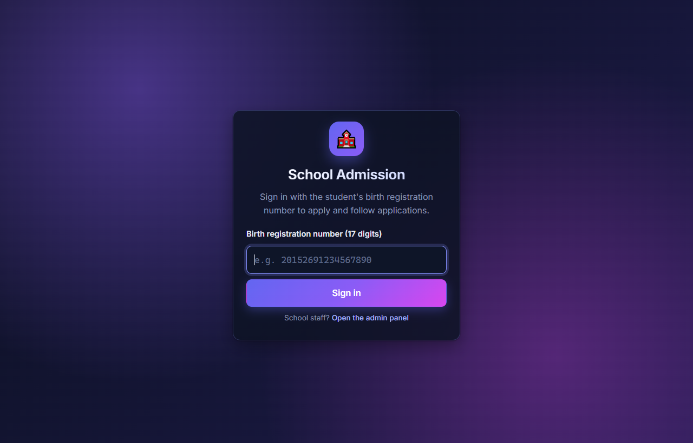](docs/screenshots/01-sign-in.png) | **Classes** — every class & shift with deadline, seats and Apply<br>[](docs/screenshots/02-class-list.png) |
| **Search & closed class** — filter by class/shift; a class past its deadline is closed<br>[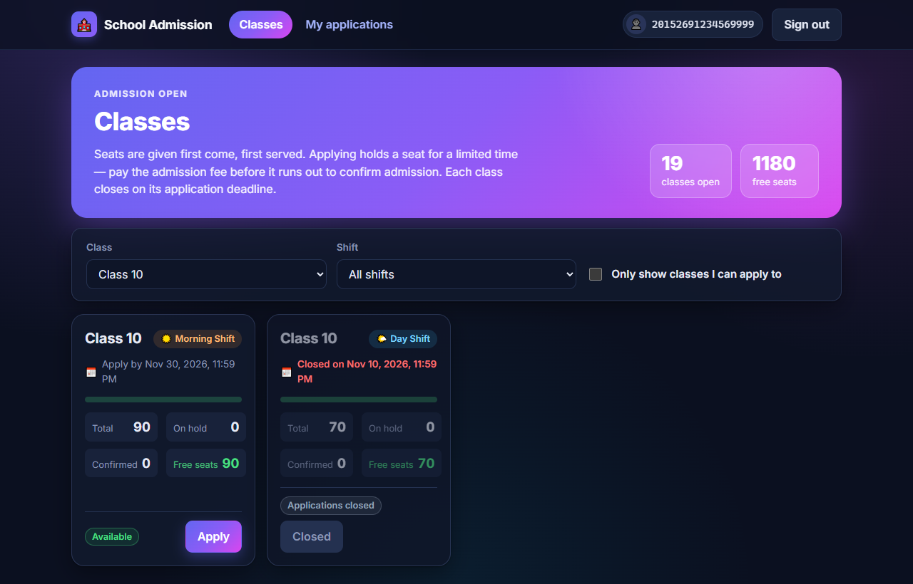](docs/screenshots/03-class-list-search.png) | **One class per student** — Apply is disabled while an application is running<br>[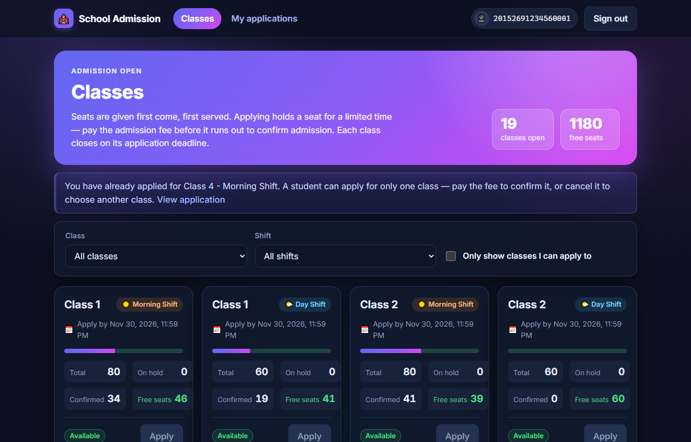](docs/screenshots/12-one-class-rule.png) |
| **Application** — live countdown, Pay admission fee, Cancel application<br>[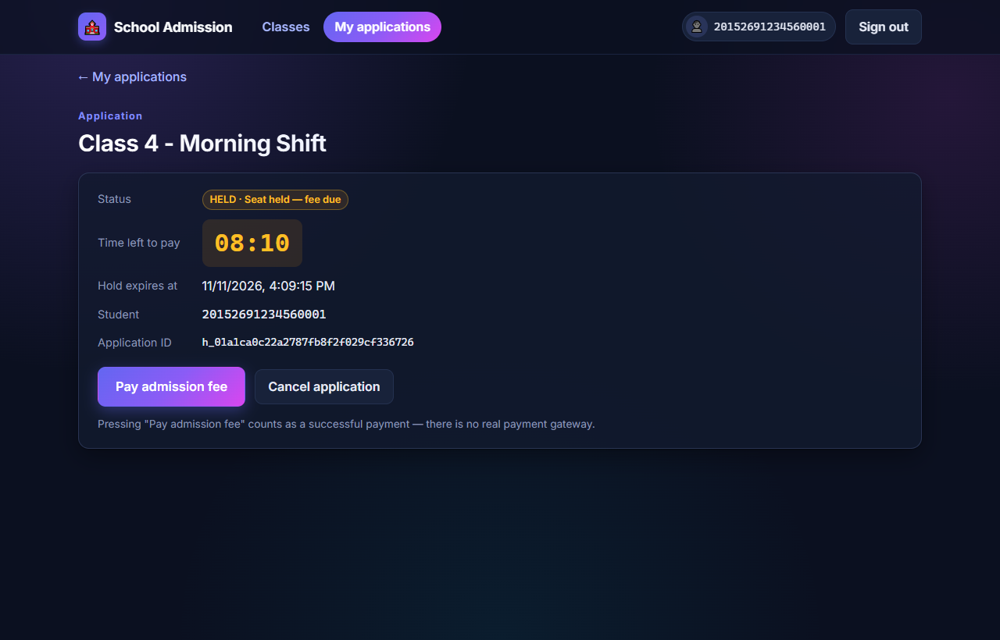](docs/screenshots/04-application.png) | **Paid** — admission confirmed<br>[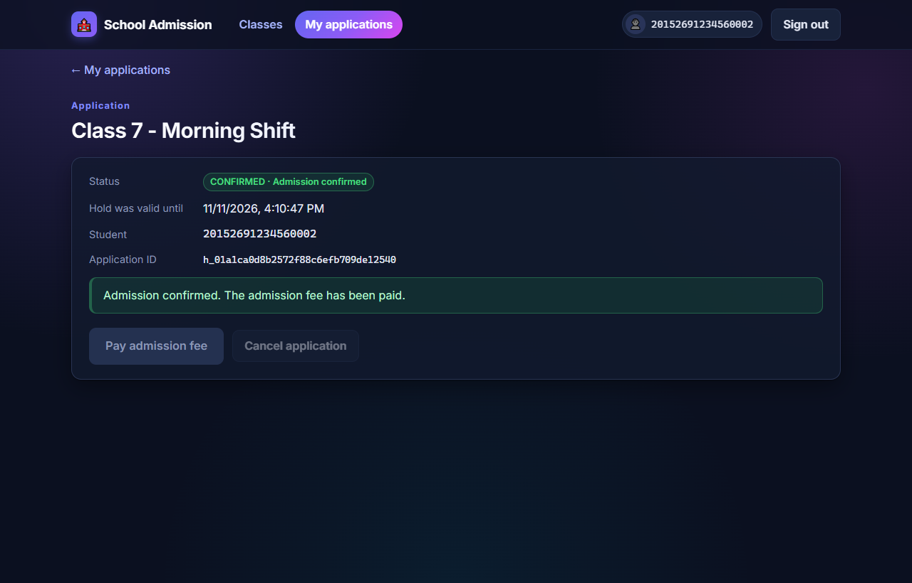](docs/screenshots/10-application-paid.png) |
| **Expired** — time ran out, seat released, paying disabled<br>[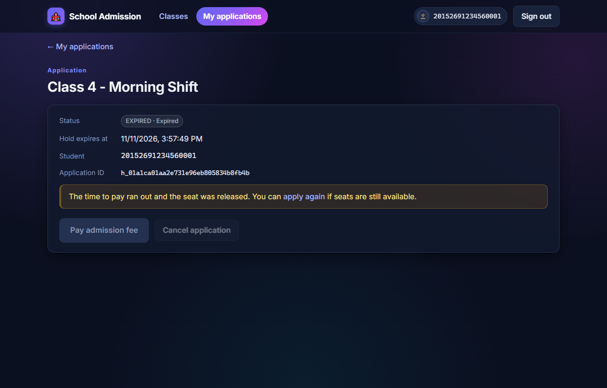](docs/screenshots/11-application-expired.png) | **My applications** — all applications of the student<br>[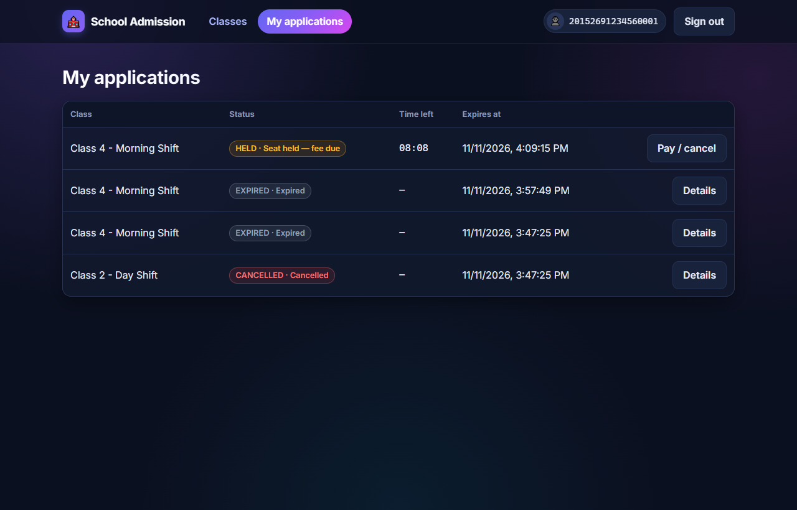](docs/screenshots/05-my-applications.png) |

### Admin panel (school)

| | |
| --- | --- |
| **Overview** — totals, seats and deadline of every class<br>[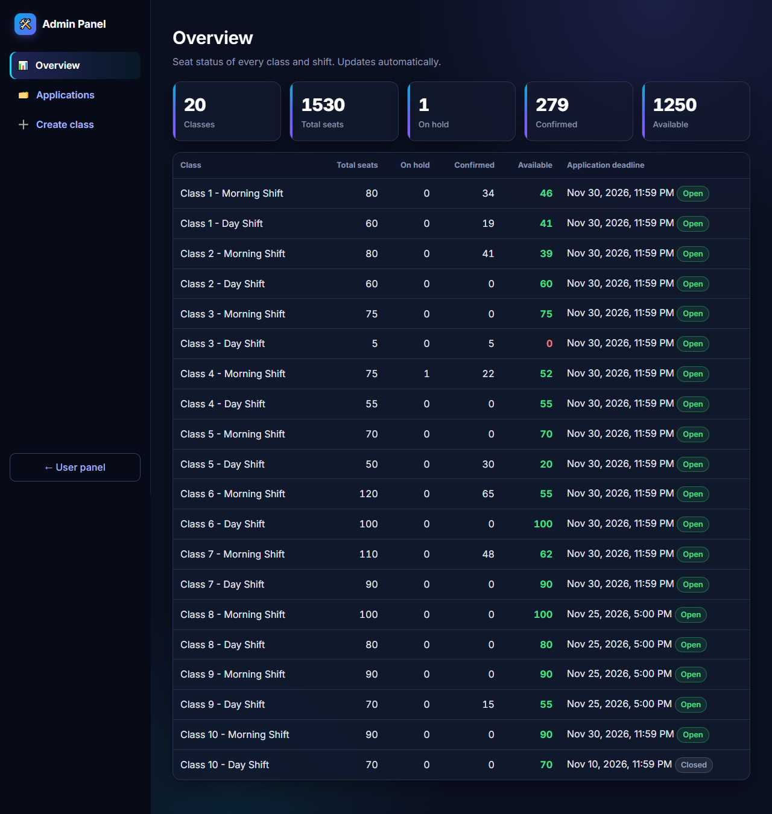](docs/screenshots/07-admin-overview.png) | **Applications** — student, class, shift, status and payment<br>[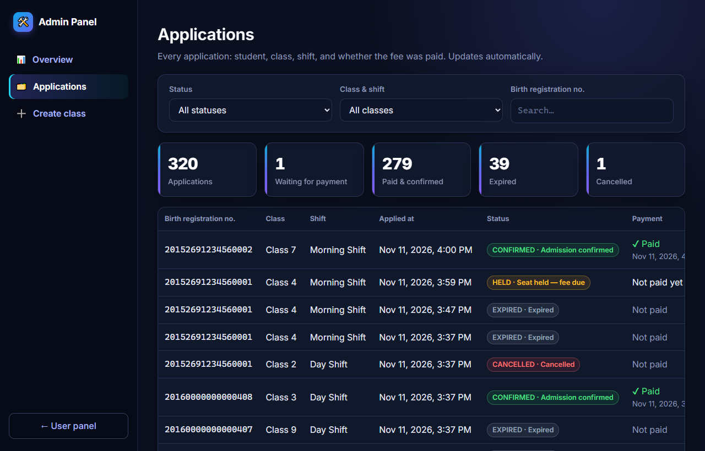](docs/screenshots/08-admin-applications.png) |
| **Applications filtered** — e.g. only paid & confirmed<br>[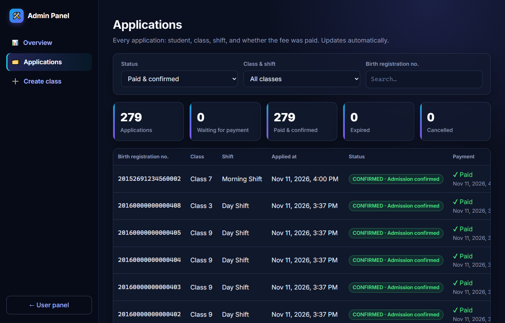](docs/screenshots/13-admin-applications-paid.png) | **Create class** — class 1–10, shift, seats, application deadline<br>[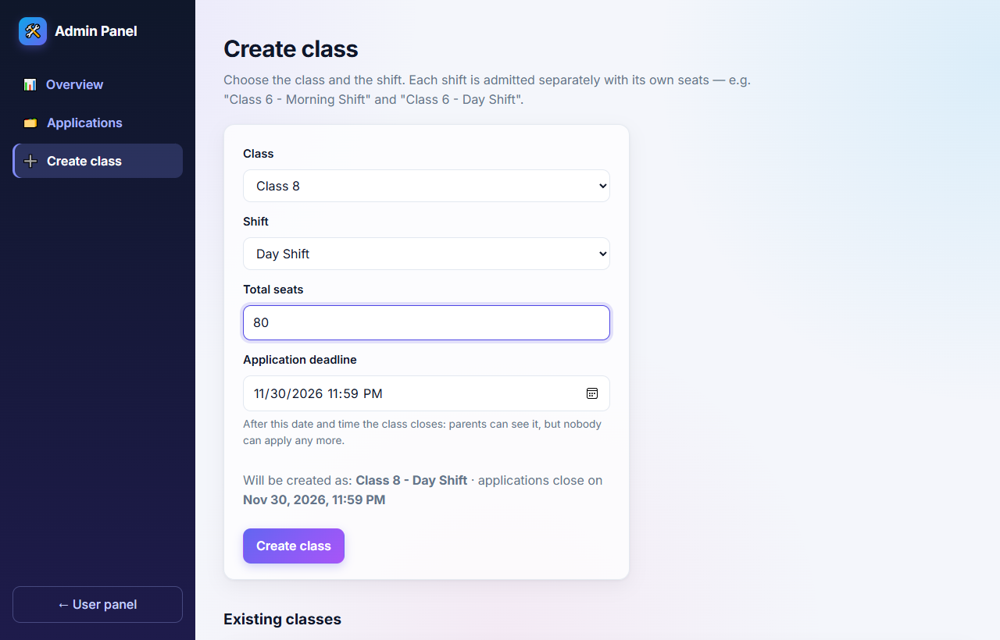](docs/screenshots/09-admin-create-class.png) |

### On a phone

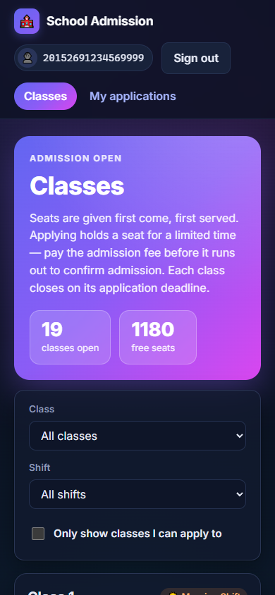 &nbsp; 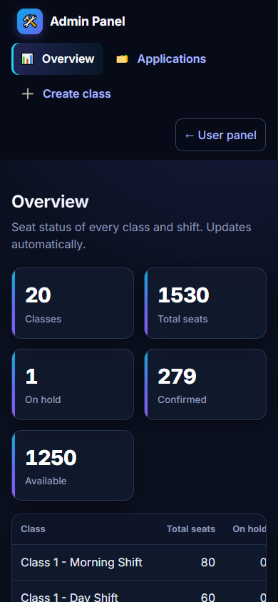

## Run it

**Requirement:** Docker (Docker Desktop on Windows/macOS) — **started and running**. Nothing else
(.NET, Node.js, PostgreSQL) needs to be installed.

```bash
git clone https://github.com/HamzaMiraz/School-Admission-System.git
cd School-Admission-System
docker compose up
```

The first run builds the images (a few minutes). PostgreSQL, the backend and the frontend start
together; the database tables are created automatically. Then open:

| What | URL |
| --- | --- |
| **User panel** (parents) | **http://localhost:3000** |
| **Admin panel** (school) | **http://localhost:3000/admin** |
| Backend API | http://localhost:8080 (e.g. http://localhost:8080/classes) |

### First steps (the database starts empty)

1. Open the **Admin panel** → **Create class** → choose e.g. *Class 6* + *Morning Shift*, enter
   *120* seats and an **application deadline** → **Create class**. Add as many classes as you like.
2. Open the **User panel** → sign in with any 17-digit number, e.g. `20152691234567890`.
3. **Classes** → pick a class → **Apply** → **Pay admission fee** (or **Cancel application**).
4. Back in the Admin panel → **Applications** to see who applied for which class and shift, and
   who has paid.

### Useful commands

| Command | What it does |
| --- | --- |
| `docker compose up` | Start (logs in the terminal; `Ctrl+C` stops) |
| `docker compose up -d` | Start in the background; the containers then also start automatically whenever Docker starts |
| `docker compose up -d --build` | Rebuild after changing the code, then start |
| `docker compose down` | Stop. Data is kept in the `pgdata` volume and is back on the next `up` |
| `docker compose down -v` | Stop **and delete all data** |

### If something goes wrong

- **"Cannot connect to the Docker daemon" / "dockerDesktopLinuxEngine"** — Docker Desktop is not
  running. Start it, wait until it says *running*, and run the command again.
- **"Port is already allocated"** — another program uses port 3000 or 8080. Stop it, or change the
  left-hand port in `docker-compose.yml` (e.g. `"3001:80"`).
- **The page says it cannot reach the server** — the backend is still starting; it reconnects
  by itself within a few seconds.

### Using the app

The UI has two panels.

**Admin panel** — http://localhost:3000/admin (school admin)

- **Overview**: seat totals and every class's seats and application deadline (Open / Closed), live.
- **Applications**: every application — student's birth registration number, class, shift, when
  they applied, status and whether the fee is paid. Filter by status, class/shift or student.
- **Create class**: choose the class (1–10) and the shift (Morning / Day), enter the seats and the
  **application deadline** (after it the class closes for new applications),
  e.g. Class 6 + Morning Shift + 120. Every shift is its own class.

**User panel** — http://localhost:3000 (parents)

1. **Sign in** with the student's **17-digit birth registration number** (no password; Bangla
   digits are accepted). The browser remembers it until **Sign out**. To try several students,
   sign out and sign in with another number, or use another browser / private window.
2. **Classes**: one card per class and shift, in order (Class 1 → 10, Morning before Day), with the
   application deadline, a seat bar and total / on hold / confirmed / free seats (refreshes every 3 s).
   Search by class and shift, or show only classes you can apply to. Each card says **Available**,
   **Full** or **Applications closed**; **Apply** works only when the class is open and has free seats. A student can apply for only one class at a time.
3. **Application** page: status, live countdown, **Pay admission fee** (payment is simulated and
   always succeeds — no real payment gateway) and **Cancel application**. When the countdown ends the page shows EXPIRED and
   paying is disabled — no reload needed.
4. **My applications**: every application of the current student and its status.

### Configuration (environment variables)

| Variable | Used by | Default | Meaning |
| --- | --- | --- | --- |
| `HOLD_DURATION_SECONDS` | backend | `600` | How long a seat stays held before it expires |
| `ONE_CLASS_PER_STUDENT` | backend | `true` | A student may have only one active application in the whole school; `false` = only one per class (the brief's rule) |
| `ConnectionStrings__Default` | backend | compose: the `postgres` service | PostgreSQL connection string (in compose set it via `DB_CONNECTION`) |
| `CORS_ALLOWED_ORIGINS` | backend | `*` | Comma-separated origins allowed to call the API |
| `API_URL` | frontend container | `http://localhost:8080` | Backend URL used by the browser; applied at container start, no rebuild |
| `VITE_API_URL` | frontend (dev / build) | `http://localhost:8080` | Same, for `npm run dev` |

Example: `HOLD_DURATION_SECONDS=60 docker compose up` (PowerShell: `$env:HOLD_DURATION_SECONDS=60; docker compose up`).

## Run the tests

With Docker only:

```bash
docker compose --profile test run --rm backend-tests    # 43 xUnit tests against a real PostgreSQL
docker compose --profile test run --rm frontend-tests   # 38 Vitest + Testing Library tests
```

Without Docker (needs .NET 10 SDK / Node 20.19+ and a PostgreSQL server):

```bash
cd backend && dotnet test        # uses TEST_DB_CONNECTION, default Host=localhost;Username=postgres;Password=postgres
cd frontend && npm ci && npm test
```

Every backend test creates its own temporary database and drops it afterwards.

What the backend tests cover ([backend/tests/](backend/tests/SchoolAdmission.Api.Tests/)):

- **Concurrency:** 150 simultaneous applications for 10 seats → exactly 10 holds, 140 × `409`;
  the same with **two API instances** sharing one database; one student firing 30 applications at
  once gets one hold; 25 simultaneous confirms of one hold count one seat.
- Expiry (with a fake clock), confirm/cancel rules, ownership (`403`), validation (`400`), `404`s,
  and that response field names match the brief.

## Second backend process (bonus)

```bash
docker compose --profile multi up
```

starts another API on **http://localhost:8081** against the same database. Seat limits still hold
because all coordination happens inside PostgreSQL — see [ASSUMPTIONS.md](ASSUMPTIONS.md#concurrency).

## API

Base URL `http://localhost:8080`. Student identity: header `X-Student-Id` (17 digits).

| # | Method & path | Purpose | Success |
| - | --- | --- | --- |
| 1 | `POST /classes` `{ "name", "totalSeats", "applicationDeadline"? }` | Create class (`applicationDeadline` is optional, ISO date-time) | `201` |
| 2 | `GET /classes` | All classes with seat counts | `200` |
| 3 | `GET /classes/{classId}` | One class's seat counts | `200` |
| 4 | `POST /classes/{classId}/holds` + `X-Student-Id` | Apply (hold a seat) | `201` |
| 5 | `GET /holds/{holdId}` | Application status | `200` |
| 6 | `POST /holds/{holdId}/confirm` + `X-Student-Id` | Pay fee, confirm admission | `200` |
| 7 | `DELETE /holds/{holdId}` + `X-Student-Id` | Cancel application | `204` |
| 8 | `GET /me/holds` + `X-Student-Id` | This student's applications | `200` |
| extra | `GET /admin/holds?status=&classId=&studentId=` | All applications (admin panel) | `200` |

Errors are JSON: `{ "error": "NO_SEATS_AVAILABLE", "message": "Sorry, all seats …" }`.
Codes: `400` invalid input, `403` someone else's application, `404` unknown id,
`409` no seats / applications closed / already applied / expired / cancelled / already confirmed.

## Project layout

```
backend/
  src/SchoolAdmission.Api/
    Api/          endpoints, request/response contracts, error handling
    Services/     AdmissionService (all rules + locking), HoldExpiryWorker
    Domain/       SchoolClass, Hold
    Data/         DbContext, migrations (applied automatically on startup)
  tests/SchoolAdmission.Api.Tests/
frontend/
  src/pages/      User panel: Login, Classes, Application, My applications
                  Admin panel: Overview, Applications, Create class
  src/components/ class cards, tables, alerts, error boundary
  src/api.ts      typed API client with human-readable errors
docker-compose.yml
```

## Run without Docker (optional, for development)

Needs the .NET 10 SDK, Node.js 20.19+ and a running PostgreSQL. The backend's development settings
([appsettings.Development.json](backend/src/SchoolAdmission.Api/appsettings.Development.json))
connect to `localhost:5432` as `postgres` / `postgres`; change them there if yours differ. Stop the
Docker version first (`docker compose down`), because both use port 8080.

```bash
# terminal 1 - backend on http://localhost:8080
cd backend && dotnet run --project src/SchoolAdmission.Api
# terminal 2 - frontend on http://localhost:5173
cd frontend && npm install && npm run dev
```
