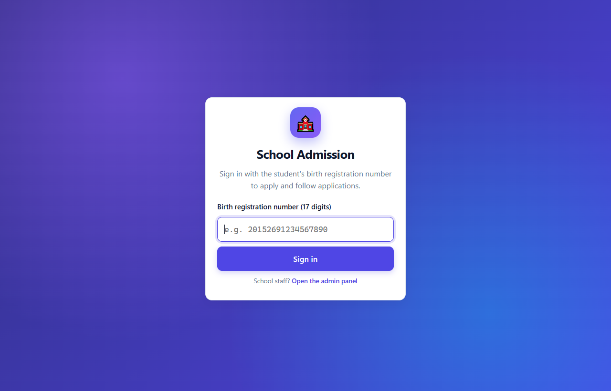
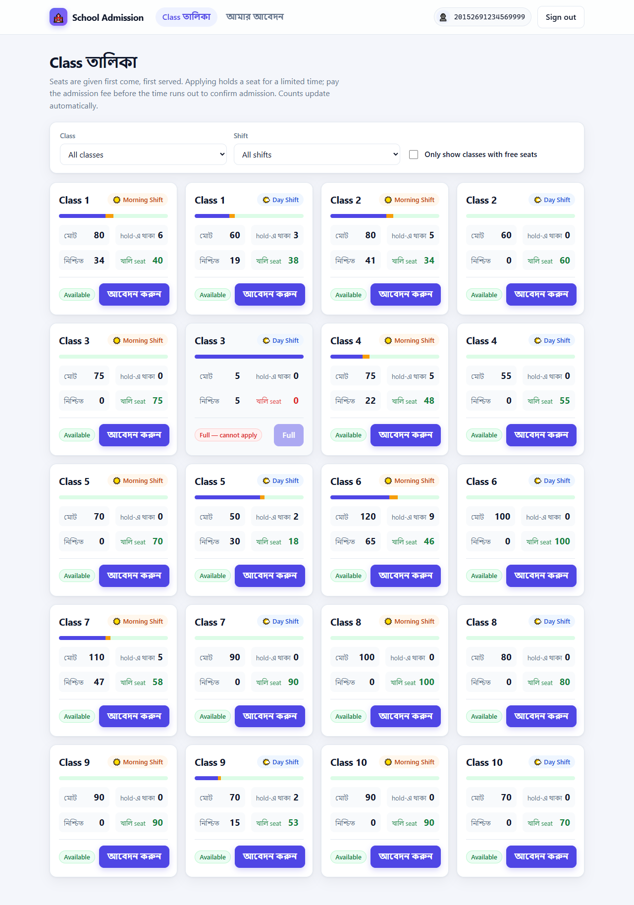
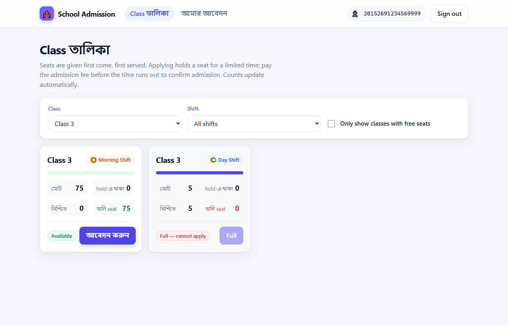
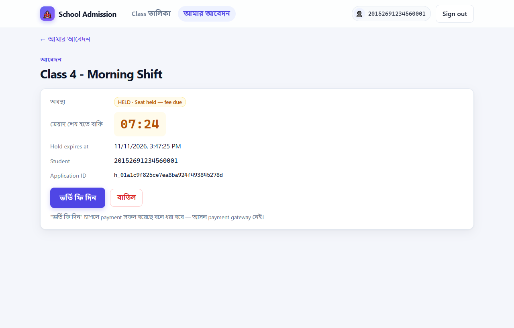
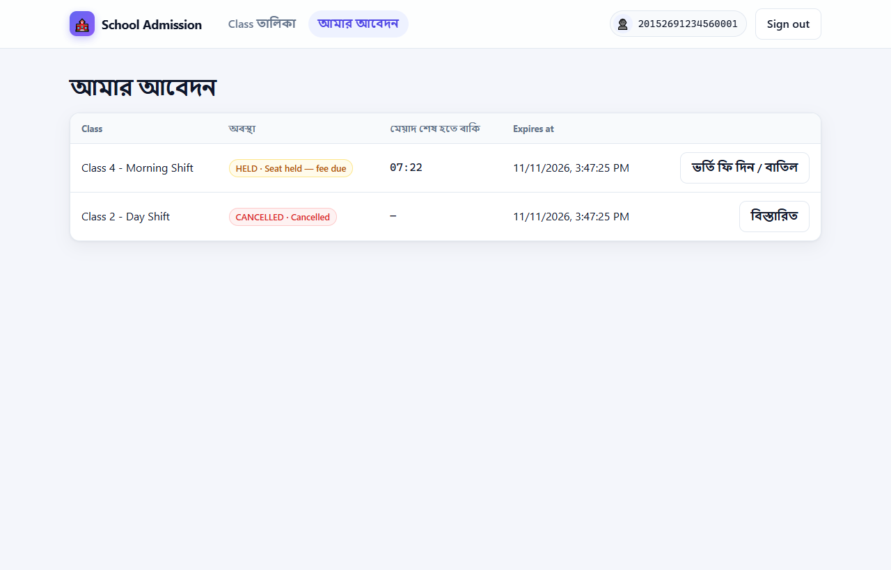
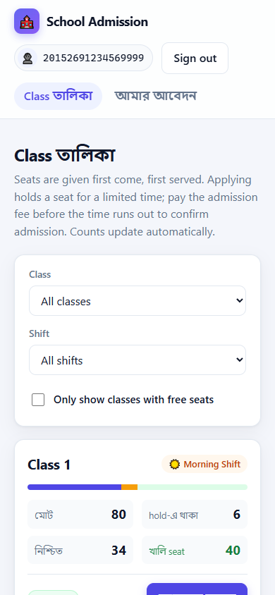
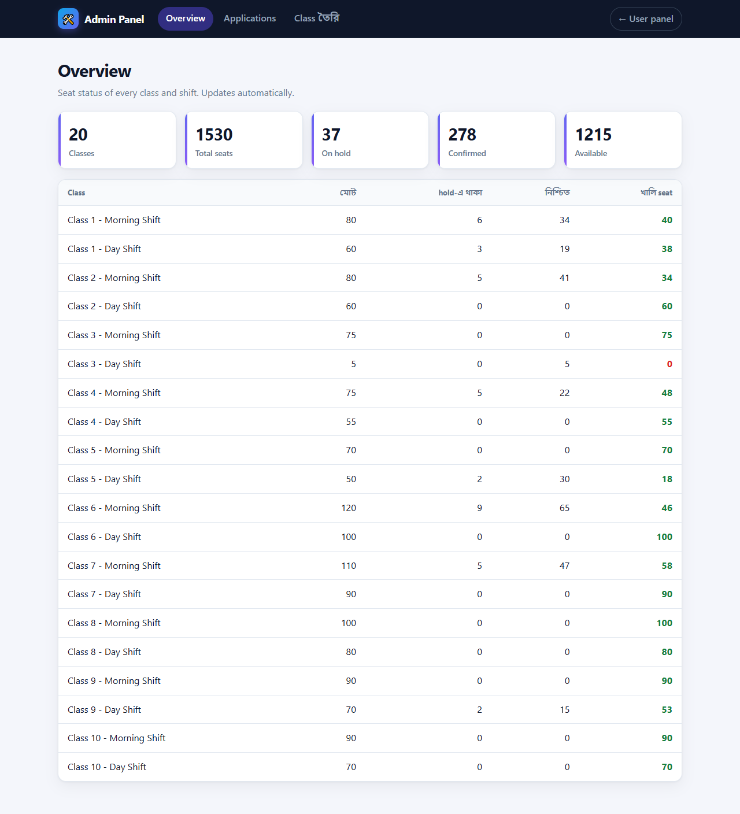
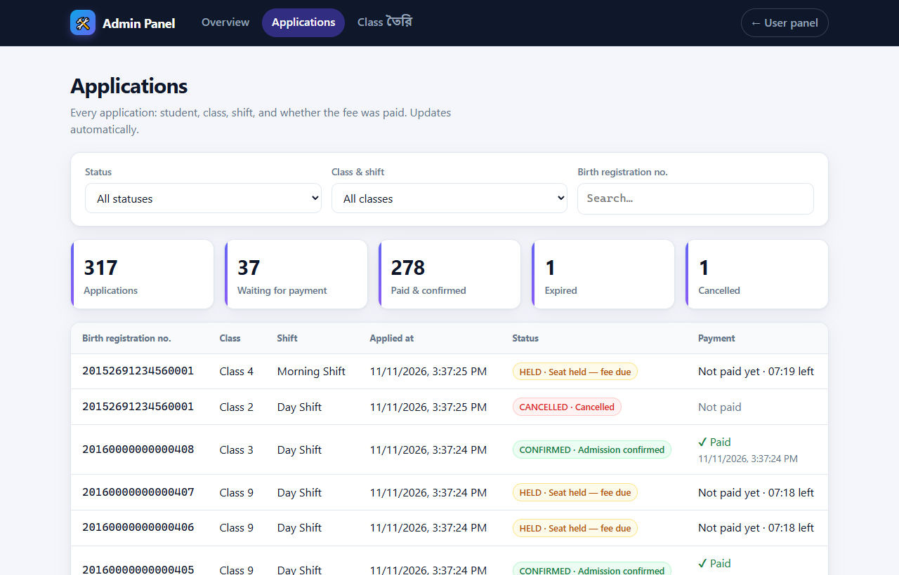
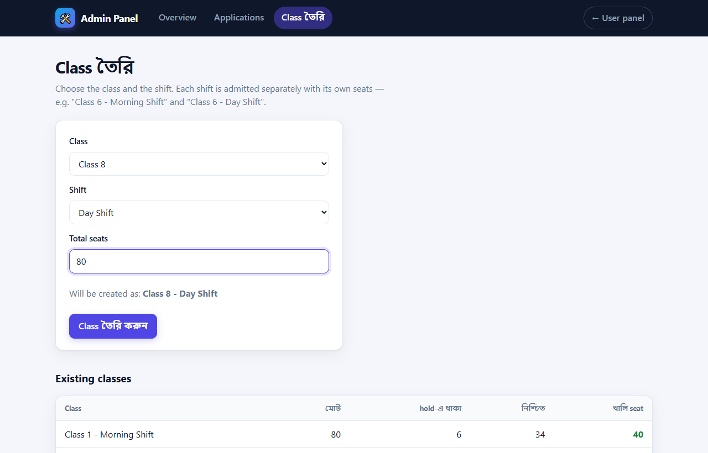

# User interface

The web app has two panels:

- **User panel** — http://localhost:3000 — for parents: sign in with the student's birth
  registration number, browse classes, apply, pay the fee or cancel, and follow applications.
- **Admin panel** — http://localhost:3000/admin — for the school: seat overview, every
  application with its payment status, and creating classes.

Screen and button names follow the brief: **Class তৈরি**, **Class তালিকা** (with "আবেদন করুন"),
**আবেদন** (with "ভর্তি ফি দিন" and "বাতিল") and **আমার আবেদন**.

> The screenshots were taken from the running app (`docker compose up`) with demo data.

---

## User panel

### Sign in

The student's 17-digit birth registration number is the identity (no password, as in the brief).
It is remembered in the browser until **Sign out**. Bangla digits are accepted.

### Class তালিকা — all classes

One card per class and shift, ordered Class 1 → Class 10, Morning before Day. Each card shows
**মোট**, **hold-এ থাকা**, **নিশ্চিত** and **খালি seat**, a seat bar (blue = confirmed,
orange = on hold, green = free), and **Available** or **Full**. Counts refresh every few seconds
without reloading the page. **আবেদন করুন** works only when seats are free.

### Search by class and shift

Filter by class and shift, or show only classes with free seats. Here *Class 3* is selected:
the Morning shift has free seats, the Day shift is full, so it cannot be applied for.

### আবেদন — one application

After applying, the seat is held. The page shows the **অবস্থা** (status), a live
**মেয়াদ শেষ হতে বাকি** countdown, and the **ভর্তি ফি দিন** and **বাতিল** buttons. Pressing
"ভর্তি ফি দিন" counts as a successful payment (no real payment gateway). When the countdown ends,
the page switches to EXPIRED and paying is disabled — without a reload.

### আমার আবেদন — my applications

Every application of the signed-in student and its status. A student can apply for only one
class at a time; after cancelling (as here) they can apply to another class.

### On a phone

The layout adapts to small screens.

---

## Admin panel

### Overview

Totals across the school and the seat situation of every class and shift, updating live.

### Applications

Every application: the student's birth registration number, class, shift, when they applied,
the status, and whether the admission fee is paid (or how much time is left to pay). Filter by
status, class & shift, or search by birth registration number.

### Class তৈরি — create a class

Choose the class (1–10) and the shift (Morning / Day) and enter the number of seats. The name is
built automatically, e.g. *Class 8 - Day Shift*. Duplicate classes are rejected.

